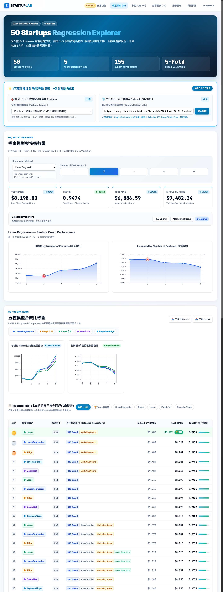
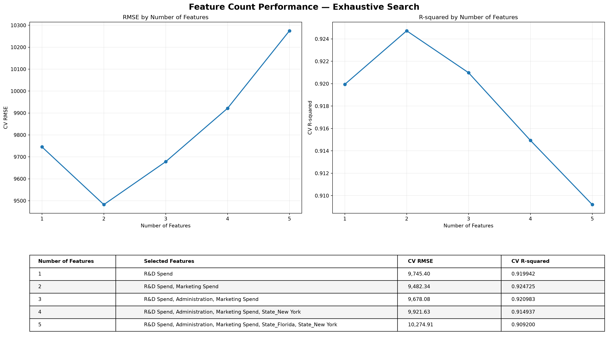
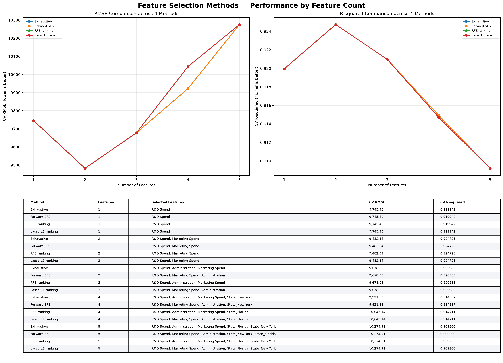
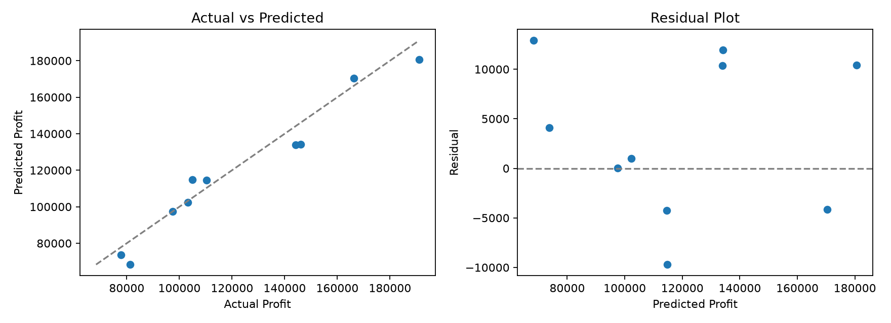

# 50 Startups — Multiple Linear Regression with CRISP-DM

[](https://www.python.org/downloads/)
[](https://scikit-learn.org/)
[](https://opensource.org/licenses/MIT)
[](https://iloveu-tw.github.io/1019_DIC2/)

本專案以 **Python / Scikit-learn** 深度分析 Kaggle **50 Startups** 資料集，完整遵循國際標準 **CRISP-DM**（Cross-Industry Standard Process for Data Mining）六大階段，構建新創公司利潤預測與特徵選擇評估管線。

專案包含完整的**本機 Python 自動化管線**（資料清理、特徵選擇、五折交叉驗證、殘差評估與模型部署檔案輸出）以及**現代化前端互動視覺化平台**（已部署至 GitHub Pages）。

---

## 🌐 互動視覺化展示平台（GitHub Pages）

* **線上體驗網址**：[https://iloveu-tw.github.io/1019_DIC2/](https://iloveu-tw.github.io/1019_DIC2/)
* **原始碼儲存庫**：[https://github.com/iloveu-tw/1019_DIC2](https://github.com/iloveu-tw/1019_DIC2)

[](https://iloveu-tw.github.io/1019_DIC2/)
*▲ 點擊上方實機截圖即可直接前往線上互動平台體驗（含 5 大模型切換、特徵篩選與 Results Table 動態評估表）*

### 平台核心功能亮點
1. **即時 4 大效能指標監控**：即時呈現 RMSE、Test $R^2$、MAE 與 MSE。
2. **單一模型特徵探勘器**：支援 5 種演算法切換與特徵維度（$k=1 \sim 5$）即時趨勢圖。
3. **五大演算法合成比較圖**：
   - 整合 `LinearRegression`、`Ridge`、`Lasso`、`ElasticNet`、`BayesianRidge` 雙折線圖（RMSE & $R^2$）。
   - **Spotlight 聚焦模式**：滑鼠懸浮或點擊圖例模型，立即加粗該線條並淡化其他模型。
   - **動態 Tooltip 懸浮數據卡**：精確呈現各資料點之特徵組合與評估數值。
4. **25 組特徵子集全面評估彙整表 (Results Table)**：
   - **金銀銅牌標章**：冠亞季軍標記（`🥇 1`、`🥈 2`、`🥉 3`），最優列高亮呼吸綠標 `🏆 最優`。
   - **專屬模型藥丸與特徵標籤晶片**：演算法品牌色與特徵色彩標記（研發藍、行銷金、行政灰、州別綠）。
   - **$R^2$ 擬合進度條**：直觀呈現各組合之解釋能力百分比。
   - **即時過濾列**：支援快速切換「全部 (25組)」、「🏆 Top 5 最佳解」及個別模型。
5. **雙研究問題即時切換 (+1 pt 加分項)**：
   - **問題一**：以研發、行銷等營運支出預測新創利潤（`Profit`）。
   - **問題二**：探討獲利規模對次期研發投資額（`R&D Spend`）之牽引效應。
6. **自訂外部資料集 URL 動態載入器 (+2 pts 加分項)**：
   - 支援填入任意公開 CSV URL 即時載入、自動解析數值欄位並動態更新全站圖表與迴歸模型。
7. **可解釋性利潤計算機**：
   - 依據 RFECV 最佳多元線性模型（$R^2 = 0.9474$, RMSE = $8,198$）即時計算預期獲利。

---

## 1. 核心研究問題與最佳模型結論

### 核心研究發現
* **最關鍵支出特徵**：在所有 5 大演算法中，**`R&D Spend`（研發支出）** 是決定公司獲利的最關鍵特徵（單特徵 $k=1$ 即可解釋約 94.65% 的利潤變異）。
* **最佳特徵子集維度**：**$k=2$** 為全域最優維度，最佳組合為 **`R&D Spend` + `Marketing Spend`**。
* **全局最優評估分數**：
  * **Test RMSE**：**$8,198**（比完整 5 特徵模型降低約 \$1,369 誤差）。
  * **Test $R^2$**：**0.9474**。
  * **5-Fold CV RMSE**：約 **$9,482**。
* **維度懲罰效應**：當特徵數量增加至 $k=3 \sim 5$（加入 `Administration` 及州別虛擬變數）時，模型發生微幅過擬合，Test RMSE 逐步上升至 \$9,567 ~ \$10,275，驗證了「奧坎剃刀原則」與特徵選擇之必要性。

---

## 2. 資料集與預處理架構

- **資料來源**：[Kaggle — 50 Startups Dataset](https://www.kaggle.com/datasets/anithabalakrishna/50-startups)
- **資料檔案**：`data/50_Startups.csv`（共 50 筆觀察值、5 個原始欄位）

| 欄位名稱 | 變數類型 | 說明 |
|---|---|---|
| `R&D Spend` | 連續數值 | 研發投入支出（美元） |
| `Administration` | 連續數值 | 行政管理支出（美元） |
| `Marketing Spend` | 連續數值 | 市場行銷推廣支出（美元） |
| `State` | 類別變數 | 公司登記州別（New York / California / Florida） |
| `Profit` | 連續數值 | **預測目標變數（Target）**：年度獲利（美元） |

### 虛擬變數編碼（Dummy Encoding）
以 `California` 作為基準參考組，將類別特徵 `State` 轉化為 `State_Florida` 與 `State_New York` 兩個二元虛擬變數，共有 **5 個候選預測變數**。

---

## 3. CRISP-DM 六大階段實施細節


| 階段 | CRISP-DM 階段名稱 | 本專案具體執行項目 |
|---|---|---|
| **P1** | **Business Understanding** | 定義新創公司支出與利潤關聯預測目標，設定 RMSE、MAE 與 $R^2$ 評估指標。 |
| **P2** | **Data Understanding** | 缺失值檢查（0 缺失）、重複值檢查、描述性統計分析、皮爾森相關係數矩陣計算與散佈圖輸出。 |
| **P3** | **Data Preparation** | One-Hot 虛擬變數編碼、80/20 訓練/測試集切分（`random_state=0`）、Pipeline 內建標準化機制。 |
| **P4** | **Modeling** | 實作 5 大演算法（OLS、Ridge、Lasso、ElasticNet、BayesianRidge）結合特徵子集搜尋。 |
| **P5** | **Evaluation** | 外層 5-Fold 交叉驗證、內層 3-Fold 特徵選擇、殘差常態性與異質變異檢驗、泛化能力對比。 |
| **P6** | **Deployment** | 產出 `joblib` 序列化模型檔、完整 JSON/CSV 實驗報告，並發布 GitHub Pages 互動平台。 |

### 5 大線性模型與特徵選擇演算法機制
1. **LinearRegression (OLS)**：透過 `itertools.combinations` 窮舉 31 種非空特徵子集取得全域基準。
2. **Ridge (L2 正則化)**：引入 L2 範數懲罰項，抑制共線性特徵權重極端發散。
3. **Lasso (L1 正則化)**：透過 L1 範數將不顯著特徵係數壓縮至精確的 0，達成稀疏特徵選擇。
4. **ElasticNet (L1 + L2)**：平衡係數收縮與特徵子集選取穩定性。
5. **BayesianRidge**：以機率框架估計參數後驗分布，自適應正則化超參數。

---

## 4. 專案目錄結構

```text
AIIS_DIC2/
├── README.md                                  # 專案完整技術報告與文檔
├── main.py                                    # 專案標準主程式進入點 (依使用者規範配置頂部變數)
├── 50_startups_crisp_dm_all_in_one.py         # 原始完整 CRISP-DM 管線程式碼
├── requirements.txt                           # Python 相依套件清單
│
├── index.html                                 # 互動式網頁展示平台主頁
├── styles.css                                 # 現代化深淺色融合與玻璃擬態樣式庫
├── app.js                                     # D3.js 動態圖表、篩選器與線上計算機邏輯
│
├── data/
│   └── 50_Startups.csv                        # 50 筆新創營運數據原始資料
│
└── results/
    └── CRISP_DM_ALL_IN_ONE/                   # 自動生成之實驗成果目錄
        ├── CRISP_DM_execution_report.md      # 完整執行成果摘要報告
        ├── P2_correlation.csv                 # 特徵相關係數矩陣
        ├── P2_data_summary.csv                # 敘述統計表
        ├── P2_feature_scatter.png             # 特徵散佈圖
        ├── P3_train_indices.csv               # 訓練集索引 (80%)
        ├── P3_test_indices.csv                # 測試集索引 (20%)
        ├── P5_methods_comparison.csv          # 多方法整體指標比較表
        ├── P5_fold_details.csv                # 5-Fold 交叉驗證逐折詳細紀錄
        ├── P5_feature_count_comparison.csv    # k=1~5 特徵數量對比表
        ├── P5_feature_count_dashboard.png     # 特徵數量效能儀表板圖
        ├── P5_feature_count_rmse.png          # RMSE 隨特徵數變化趨勢圖
        ├── P5_feature_count_r2.png            # R² 隨特徵數變化趨勢圖
        ├── P5_four_methods_feature_count.csv  # 多方法特徵數量明細表
        ├── P5_four_methods_feature_count.png  # 多演算法特徵數量基準對照圖
        ├── P5_evaluation_plots.png            # 實際值 vs 預測值與殘差診斷圖
        ├── P5_test_predictions.csv            # 測試集實際值與預測值紀錄
        ├── P6_experiment_summary.json         # 機器可讀之實驗結果彙整 JSON
        └── P6_model.joblib                    # 最佳保存模型檔案
```

---

## 5. 安裝與執行說明

### 環境需求
* **Python**：3.10 或更高版本
* **作業系統**：macOS / Linux / Windows

### 1. 建立虛擬環境與安裝相依套件
```bash
# 複製儲存庫
git clone https://github.com/iloveu-tw/1019_DIC2.git
cd 1019_DIC2

# 安裝所需 Python 套件
pip install -r requirements.txt
```

### 2. 執行 CRISP-DM 機器學習管線
```bash
# 執行標準入口 main.py
python3 main.py
```
執行完成後，控制台將列印每階段驗證結果，並自動在 `results/CRISP_DM_ALL_IN_ONE/` 下產出所有圖表與報表。

### 3. 本地啟動互動式網頁預覽
若需在本機預覽互動式展示平台：
```bash
# 使用 Python 內建 HTTP 伺服器
python3 -m http.server 8080
```
開啟瀏覽器訪問 `http://localhost:8080` 即可體驗完整功能。

---

## 6. 實驗成果圖表解析

### 6.1 特徵數量效能儀表板 (Feature Count Dashboard)
展示特徵維度 $k=1 \sim 5$ 時，RMSE（左）與 $R^2$（右）的變化走勢。可明確看出在 $k=2$ 時達到最低 RMSE 與最高 $R^2$。



* **圖檔路徑**：`results/CRISP_DM_ALL_IN_ONE/P5_feature_count_dashboard.png`
* **詳細數據**：`results/CRISP_DM_ALL_IN_ONE/P5_feature_count_comparison.csv`

---

### 6.2 多演算法基準比較圖 (Master Benchmark Plot)
比對 5 大特徵選擇與迴歸演算法在各維度下的泛化能力，確認演算法之間的收斂一致性。



* **圖檔路徑**：`results/CRISP_DM_ALL_IN_ONE/P5_four_methods_feature_count.png`
* **詳細數據**：`results/CRISP_DM_ALL_IN_ONE/P5_four_methods_feature_count.csv`

---

### 6.3 殘差診斷與預測擬合度評估
包含「實際值 vs. 預測值散佈圖」（緊貼 45 度理想對角線）及「預測值 vs. 殘差圖」（殘差均勻分散於 0 水平線兩側，無明顯異質變異）。



* **圖檔路徑**：`results/CRISP_DM_ALL_IN_ONE/P5_evaluation_plots.png`
* **詳細數據**：`results/CRISP_DM_ALL_IN_ONE/P5_test_predictions.csv`

---

## 7. 評估指標對照表

| 指標名稱 | 全名 | 數學定義／物理意義 | 優化方向 |
|---|---|---|---|
| **MAE** | Mean Absolute Error | $\frac{1}{n} \sum \|y_i - \hat{y}_i\|$，平均預測偏差金額 | 越低越好 |
| **MSE** | Mean Squared Error | $\frac{1}{n} \sum (y_i - \hat{y}_i)^2$，重懲大誤差之平方均值 | 越低越好 |
| **RMSE** | Root Mean Squared Error | $\sqrt{\text{MSE}}$，單位與利潤一致（美元） | 越低越好 |
| **$R^2$** | Coefficient of Determination | $1 - \frac{\sum (y_i - \hat{y}_i)^2}{\sum (y_i - \bar{y})^2}$，模型對利潤變異的解釋比例 | 越高越好（上限 1.0） |

---

## 8. 可重現性宣告與研究限制

1. **隨機狀態固定**：全管線嚴格固定 `random_state=0`，確保資料切分與交叉驗證折數可 100% 精確重現。
2. **防範資料洩漏（Data Leakage）**：特徵標準化均封裝於 `Pipeline` 中，在交叉驗證折內個別擬合，嚴格杜絕測試集資訊洩漏。
3. **樣本規模限制**：本資料集為 50 筆新創公司之樣本，雖然具備極高代表性，但在極端市場情況下的泛化能力仍需擴充樣本檢驗。
4. **相關性不等於因果性**：統計迴歸顯著性代表營運資金配置與利潤在歷史樣本中的高關聯，投資人仍須審慎考量總體經濟與產業競爭環境。

---

## 9. 授權與技術堆疊

* **核心技術**：Python 3 · Scikit-learn · Pandas · NumPy · Matplotlib · D3.js · HTML5 / CSS3 (Vanilla)
* **軟體授權**：MIT License
* **專案維護者**：[iloveu-tw](https://github.com/iloveu-tw)
